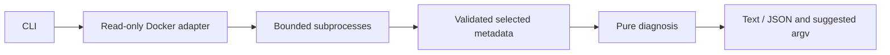

# Architecture

`process.ts` spawns Docker without a shell, bounds output/time and translates errors. `docker.ts` queries active services, all project containers with untruncated IDs, and a fixed inspect template in batches of 50 IDs. The template selects one Compose label and status metadata, never env or healthcheck output.

`normalize.ts` supports JSON arrays and JSON Lines, validates essential fields and merges IDs. Exposed-but-unpublished ports are dropped. Missing inspection results are an incomplete report, never a silently omitted replica. `diagnose.ts` computes per-service readiness without changing inputs. `report.ts` formats static explanations and quoted read-only suggestions; `cli.ts` owns flags, output and exit codes.

Compose owns interpolation, file merging, profiles and current context selection. No YAML parser, Docker SDK or production dependencies are needed. Unit tests isolate runtime data; the separate integration test uses a real disposable project to validate unhealthy→healthy behavior and profile selection.
